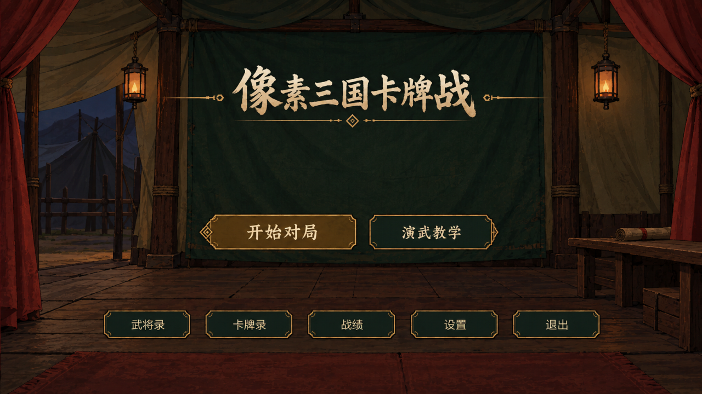

# 像素三国卡牌战

使用 Python 与 pygame-ce 制作的单机三国题材卡牌游戏：标准版25将、108张实体牌，支持 AI 对战、实战教学、图鉴、设置和战绩。

Python／pygame-ce桌面项目，Windows完整包和源码见[Releases](https://github.com/Zody-4/pixel-sanguosha/releases)。代码开源，图片和声音并非全部采用同一开源许可，详见下方素材说明。



## 游戏内容

- 斗将1v1、力敌双雄1v2、五人身份局。
- 简单、中等、困难 AI，阵亡观战与本局调速。
- 基础、进阶、模式实战教学，卡牌录与武将录。
- 音乐、报牌、音效独立调节，窗口和牌面详情设置。
- 本地设置、战绩摘要和 PC 故障诊断。

玩法已接入，当前 AI 难度已被作者接受，不宣称最优策略。项目与三国杀官方无隶属关系，未声明官方授权。本次发布范围为 Windows 桌面。

## 源码启动

开发基线：Windows、Python 3.12.10、pygame-ce 2.5.8。
完整源码发行保留运行所需目录和资源。在根目录执行：

```powershell
py -3.12 -m venv .venv
.\.venv\Scripts\python.exe -m pip install -r requirements.txt
.\.venv\Scripts\python.exe run_game.py
```

保留src、assets、Music目录结构，路径、哈希和许可状态见[资源清单](docs/release/runtime-assets.json)。默认的仅已核实素材导出不是完整游戏；Releases的完整发行包与本仓库则包含现有运行资源及来源说明。

## Windows exe 与补丁

完整解压后运行 xssgkpz.exe，保留 _internal，无需安装 Python。新完整构建已包含 PC 诊断，不再叠加旧补丁。
旧诊断补丁只增加本地记录，不能认定白屏／无响应已修复，且只适配原交付运行库。详见 [Windows 发布说明](docs/release/WINDOWS_RELEASE.md)。

## 设置与隐私

Windows默认保存于`%LOCALAPPDATA%\xssgkpz\`：settings.json为设置，records.jsonl为战绩摘要，不支持续局。diagnostics/保存操作、状态、线程和异常记录，仅本地保存，不自动上传。
游戏内个人微信联系方式已移除，反馈使用[GitHub Issues](https://github.com/Zody-4/pixel-sanguosha/issues)，附版本、Windows版本、复现步骤及必要截图。日志分享前检查个人路径等信息，只提供最小相关片段。

## 开发与发布

src/xssgkpz/core/是规则与AI，data/是静态数据。其余模块提供pygame界面、音频及存储。测试与贡献见 [开发说明](docs/release/DEVELOPMENT.md)。
2026-10-08在独立Python环境完成243项测试，源码及exe单帧启动检查通过。启动使用隔离用户数据与SDL dummy驱动，不等同完整对局、声音试听或另一台Windows电脑验收。详见[验证记录](docs/release/VERIFICATION.md)。

```powershell
.\.venv\Scripts\python.exe tools/prepare_open_source.py --output dist/open-source-review
```

工具默认仅导出已登记可分发素材。按照本次发行保留既有第三方素材并附来源说明的选择，完整发行需显式加`--include-unverified-assets`。该选项不将未知许可改为已授权；导出不复制原Git历史、内部项目记录或个人数据。

## 许可与素材

有权授权的代码使用[MIT](LICENSE)。作者确认AI生成的25张人物、锦囊、小配件及其他图像按[CC BY 4.0](docs/release/ASSET_LICENSE.md)提供，授权范围以清单为准；杀的参考形象、身份卡、装备插画来自老版经典卡牌形象，不作原创或已取得第三方授权的声明。字体、声音和第三方库分别处理，见[许可范围](NOTICE.md)、[素材说明](docs/release/ASSETS.md)与[素材来源及侵权联系](docs/release/ASSET_CREDITS.md)。治疗／受伤音效为外部录音转换版本，按作者要求保留并标来源；“如有侵权联系删除”不等于已取得再分发授权。

源码不包含本机制作环境、参考素材库、内部交接记录或旧私有仓库历史。
